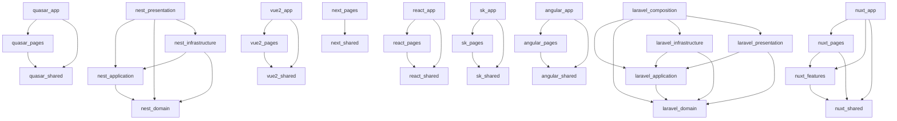

<!-- GENERATED из arch.model.json (фича 16, ADR-030). НЕ ПРАВИТЬ РУКАМИ: правь модель, затем devst arch canon -->
# Архитектура: роли и границы

> **Статус:** генерируемая проекция arch.model.json (ручные правки детектятся) · **Обновлено:** 2026-10-30
> **Суть:** карта архитектурных ролей и разрешённых границ — правится через модель, не руками.

> defaultDeny: да (не разрешено явно — запрещено)

## Роли

| Роль | Пути | Флаги | Откуда (why) |
|---|---|---|---|
| nest/domain | backend/nestjs/src/domain/** | циклы внутри запрещены | Clean: сущности и ошибки контракта; не зависят ни от кого |
| nest/application | backend/nestjs/src/application/** | — | Clean: use-cases (сервисы фич, порты, конфиг); зависят только от domain; Repository<T> TypeORM считается портом к данным |
| nest/infrastructure | backend/nestjs/src/infrastructure/** | — | Clean: адаптеры — S3-хранилище (реализация порта ImageStorage), логгер |
| nest/presentation | backend/nestjs/src/presentation/** | — | Clean: HTTP-слой — контроллеры, DTO, гарды, фильтр ошибок, метрики, health |
| laravel/domain | backend/laravel/app/Domain/** | циклы внутри запрещены | Clean: Eloquent-модели как доменные сущности (прагматичный Clean, ADR-014); не зависят ни от кого |
| laravel/application | backend/laravel/app/Application/** | — | Clean: use-cases — сервисы (CartResolver и будущие) |
| laravel/infrastructure | backend/laravel/app/Infrastructure/** | — | Clean: адаптеры; пока пусто — матрица охраняет направление на будущее |
| laravel/presentation | backend/laravel/app/Http/** | — | Clean: HTTP-слой Laravel — контроллеры, Requests, Resources, Middleware |
| laravel/composition | backend/laravel/app/Providers/** | — | Корень композиции Laravel: провайдеры связывают слои |
| quasar/app | frontend/vue-quasar/src/app/** | — | FSD-слой app: App.vue, main, router |
| quasar/pages | frontend/vue-quasar/src/pages/** | slices (горизонтали слайсов запрещены) | FSD-слой pages: экраны-слайсы, горизонталь запрещена |
| quasar/shared | frontend/vue-quasar/src/shared/** | — | FSD-слой shared: api-клиент, сторы |
| vue2/app | frontend/vue2/src/app/** | — | FSD-слой app: App.vue, main, router |
| vue2/pages | frontend/vue2/src/pages/** | slices (горизонтали слайсов запрещены) | FSD-слой pages: экраны-слайсы, горизонталь запрещена |
| vue2/shared | frontend/vue2/src/shared/** | — | FSD-слой shared: api-клиент, стор |
| react/app | frontend/react/src/app/** | — | FSD-слой app: App, main |
| react/pages | frontend/react/src/pages/** | slices (горизонтали слайсов запрещены) | FSD-слой pages: экраны-слайсы, горизонталь запрещена |
| react/shared | frontend/react/src/shared/** | — | FSD-слой shared: api-клиент, стор, ui-обёртки |
| next/pages | frontend/next/src/app/** | — | FSD-слой pages: App Router Next — роутинг и экраны (src/app — конвенция Next, ADR-014); slices не включены — файлы маршрута не слайсы, кросс-импорты внутри app/ — идиома фреймворка |
| next/shared | frontend/next/src/shared/** | — | FSD-слой shared: client/server api-клиенты |
| sk/app | frontend/sveltekit/src/routes/+layout* | — | FSD-слой app: корневая оболочка SvelteKit (+layout) |
| sk/pages | frontend/sveltekit/src/routes/** | slices (горизонтали слайсов запрещены) | FSD-слой pages: маршруты SvelteKit — экраны-слайсы |
| sk/shared | frontend/sveltekit/src/shared/** | — | FSD-слой shared: api, сессия, ui |
| nuxt/app | frontend/nuxt/app.vue | — | FSD-слой app: корневая оболочка Nuxt |
| nuxt/pages | frontend/nuxt/pages/** | slices (горизонтали слайсов запрещены) | FSD-слой pages: экраны-слайсы |
| nuxt/features | frontend/nuxt/features/** | slices (горизонтали слайсов запрещены) | FSD-слой features: фича auth (форма) |
| nuxt/shared | frontend/nuxt/shared/** | — | FSD-слой shared: api, сессия (auto-import настраивается в nuxt.config) |
| angular/app | frontend/angular/src/app/app.* | — | FSD-слой app: корневой компонент, конфиг, роуты Angular |
| angular/pages | frontend/angular/src/app/pages/** | slices (горизонтали слайсов запрещены) | FSD-слой pages: экраны-компоненты |
| angular/shared | frontend/angular/src/app/shared/** | — | FSD-слой shared: сессия-сервис |

## Границы (разрешённые импорты)

## Контракты узлов

| Роль | Контракт |
|---|---|
| quasar/pages | slices: горизонтали между слайсами запрещены |
| vue2/pages | slices: горизонтали между слайсами запрещены |
| react/pages | slices: горизонтали между слайсами запрещены |
| sk/pages | slices: горизонтали между слайсами запрещены |
| nuxt/pages | slices: горизонтали между слайсами запрещены |
| nuxt/features | slices: горизонтали между слайсами запрещены |
| angular/pages | slices: горизонтали между слайсами запрещены |
